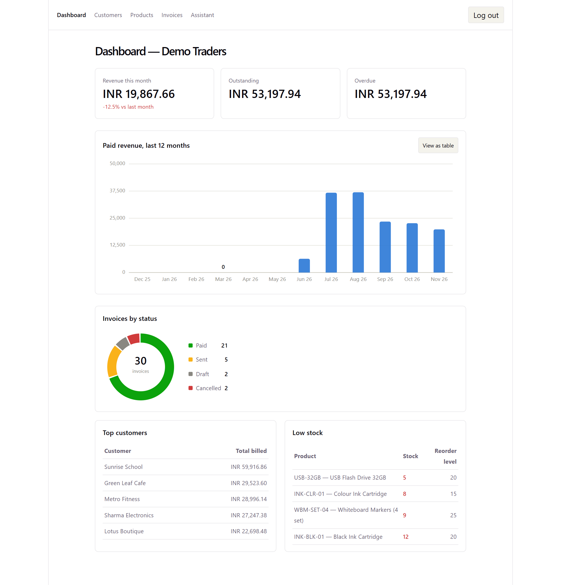
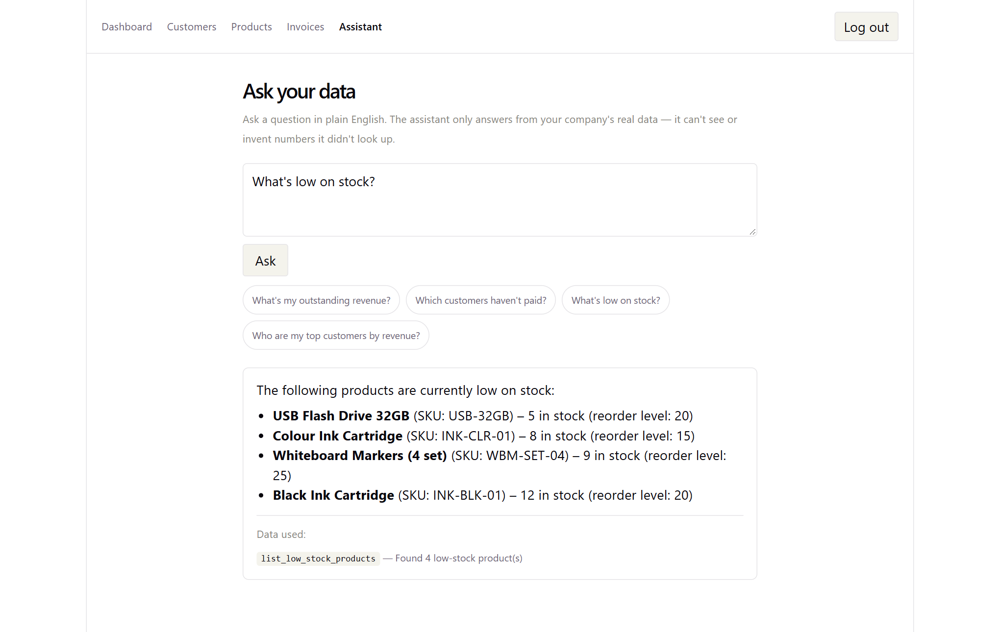
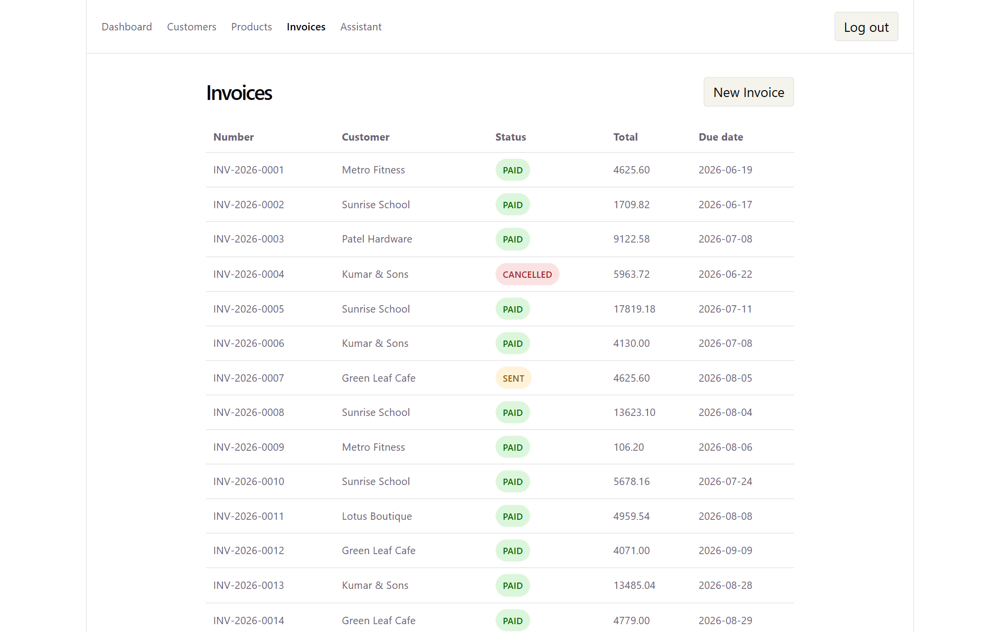
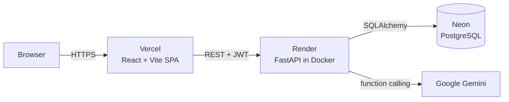

# BizOps AI

**Multi-tenant invoicing, inventory and analytics for small businesses, with an AI assistant that answers questions from the company's own data.**

### 🔗 [Live demo → bizops-ai-xi.vercel.app](https://bizops-ai-xi.vercel.app)

Click **Admin**, **Manager** or **Employee** on the login page to sign in to a sample company. No sign-up needed.
*Hosted on free tiers, so the first load after a quiet spell can take up to a minute while the API wakes up.*



| AI assistant | Invoices |
|---|---|
|  |  |

---

## Features

- **Dashboard**: revenue this month vs last, outstanding and overdue totals, a 12-month paid-revenue chart, invoice status breakdown, top customers and low-stock alerts.
- **Invoices with a real workflow**: Draft → Sent → Paid / Cancelled. Sending an invoice takes stock out, and cancelling it puts the stock back. Only drafts can be edited. Each invoice can be downloaded as a PDF.
- **Customers and products**: deleting archives them instead, so past invoices keep their references.
- **AI assistant**: ask "Which customers haven't paid?" in plain English. Gemini uses function calling to choose from a set of read-only tools, and every answer lists the data it used.
- **Multi-tenancy and roles**: each company sees only its own data. Admin, Manager and Employee roles get different permissions.

## Tech stack

| Layer | Technology |
|---|---|
| Frontend | React 19, TypeScript, Vite, React Router |
| Backend | Python 3.12, FastAPI, SQLAlchemy 2, Alembic, Pydantic |
| Database | PostgreSQL |
| AI | Google Gemini (function calling) |
| Auth | JWT, bcrypt, role-based access |
| Other | ReportLab (PDFs), Docker and Docker Compose |
| Hosting | Vercel (frontend), Render (API, Docker), Neon (Postgres) |

## Architecture



## Engineering highlights

- **Tenant isolation is enforced automatically, not left to each query.** A middleware reads the company from the JWT into a context variable. A SQLAlchemy `do_orm_execute` hook then adds a tenant filter to every ORM query, so an endpoint that forgets to filter still can't leak another company's data. Building this exposed a real cross-tenant leak, which is now fixed.
- **The AI can't reach outside its tenant.** Every assistant tool is read-only and has no company or tenant parameter. Each one wraps a service function that is already scoped to the current tenant, so neither the model nor a crafted prompt has a way to ask for another company's records.
- **The AI only answers from real data.** The assistant runs a bounded tool-calling loop, and the UI shows which tools were called for each answer.
- **Invoices behave like financial records.** Once issued they can't be edited, status changes follow allowed transitions only, and stock moves with them.
- **The public demo stays clean.** On startup the API applies migrations and rebuilds the demo company once it's more than 24 hours old, so dates stay current and visitors' edits are undone.

---

## Quick start (Docker)

Requires Docker Desktop running. From this folder:

```bash
docker compose up -d --build
docker compose exec backend python -m app.seed   # optional demo data
```

- App: http://localhost:5173 · API: http://localhost:8000/docs
- Demo logins (password `demo1234`): `admin@demo.bizops`, `manager@demo.bizops`, `employee@demo.bizops`
- Set `GEMINI_API_KEY` (and a real `JWT_SECRET_KEY`) in your shell or a `.env` next to
  `docker-compose.yml` to enable the AI assistant.

## Roles

| Action | Employee | Manager / Admin |
|---|---|---|
| View everything, add/edit customers, create/send invoices, mark paid | ✅ | ✅ |
| Add/edit/archive products, archive customers, cancel invoices | ❌ | ✅ |

"Delete" on customers and products archives them (they stay on past invoices).

## Running the backend

```bash
cd backend
python -m venv venv
venv\Scripts\activate        # Windows
# source venv/bin/activate   # macOS/Linux
pip install -e .
copy .env.example .env       # Windows, then fill in real values
alembic upgrade head
python -m app.seed           # optional demo data
uvicorn app.main:app --reload --port 8000
```

API runs at `http://localhost:8000`. See `backend/README.md` for details.

## Running the frontend

```bash
cd frontend
npm install
copy .env.example .env       # Windows, then fill in real values
npm run dev
```

App runs at `http://localhost:5173` and calls the backend's `/health`
endpoint on load to confirm the two sides can talk to each other.

## Prerequisites

- Python 3.12+
- Node.js 20+
- A PostgreSQL database (for `DATABASE_URL`)

## Deployment (free tier)

| Part | Host | Config |
|---|---|---|
| PostgreSQL | [Neon](https://neon.tech) | copy the pooled connection string |
| API | [Render](https://render.com) (Docker) | `render.yaml` blueprint |
| Frontend | [Vercel](https://vercel.com) (Vite) | `frontend/vercel.json`, root directory `frontend` |

1. **Neon** — create a project and copy its connection string (`postgresql://...?sslmode=require`).
2. **Render** — *New → Blueprint*, pick this repo. Fill in `DATABASE_URL` (Neon), `CORS_ORIGINS`
   (the Vercel URL, no trailing slash) and optionally `GEMINI_API_KEY`. `JWT_SECRET_KEY` is generated.
   Migrations run and the demo company is seeded on startup (`SEED_DEMO_DATA=true`).
3. **Vercel** — import the repo, set *Root Directory* to `frontend`, add
   `VITE_API_URL=https://<your-render-service>.onrender.com`, deploy.
4. Back on Render, make sure `CORS_ORIGINS` matches the final Vercel domain.

The free Render instance sleeps after ~15 minutes idle; the first request after that takes
up to a minute, and the login page tells visitors so.
